# PocketLedger 🪙

[](https://openjdk.org/)
[](https://spring.io/projects/spring-boot)
[](https://gradle.org/)
[](https://flutter.dev/)
[](https://www.postgresql.org/)
[](https://pocketledger-backend.onrender.com/api/v1/health)
[](https://jwt.io/)

> **PocketLedger** is a full-stack personal finance, budgeting, and savings-milestone ecosystem built with a modern **Flutter 3** mobile client and a **6-module Gradle Spring Boot 3** REST API backed by **PostgreSQL** and deployed on **Render**.

---

## 📱 Mobile App Showcase (All 10 Screens & Flows)

### 1. Dual-Theme Financial Dashboard (Light & Dark Modes)
Designed around an **Editorial Alabaster & Oceanic Teal** light theme and an **Obsidian & Luminous Teal** dark theme with a floating glassmorphic navigation dock.

| ☀️ Editorial Light Mode Dashboard | 🌙 Obsidian Dark Mode Dashboard |
| :---: | :---: |
| 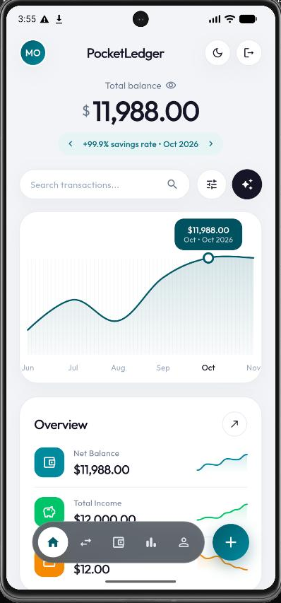 | 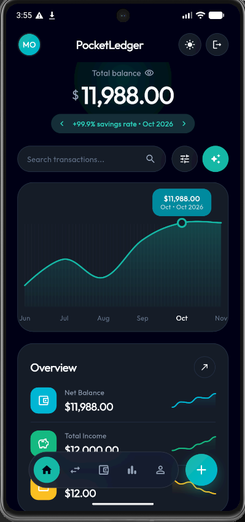 |
| **Hero Total Balance & Cashflow Spline**: Features a superscript currency balance with a one-tap **Privacy Eye (`👁️`)** mask toggle, monthly savings-rate switcher pill (`+99.9% savings rate • Oct 2026`), interactive cubic-Bezier cashflow spline curve with callout tooltip (`$11,988.00`), **Overview** Bento card with inline sparklines (`Net Balance`, `Total Income`, `Total Expenses`), and a floating frosted-glass bottom dock. | **One-Tap Live Dark Mode**: Tapping the top-right theme button (`🌙` / `☀️`) switches seamlessly to a deep carbon-obsidian (`#090D16`) canvas with midnight-slate (`#131B2E`) Bento cards, subtle hairline borders, and glowing luminous-teal (`#14B8A6`) spline curves and badges. |

---

### 2. Transaction Ledger & Quick Entry
Search, filter, and record income or expense entries with instant dashboard and budget recalculation.

| 📋 Date-Grouped Transaction Ledger | ➕ Record Transaction Bottom Sheet |
| :---: | :---: |
| 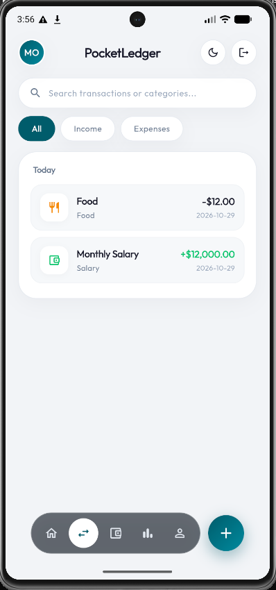 | 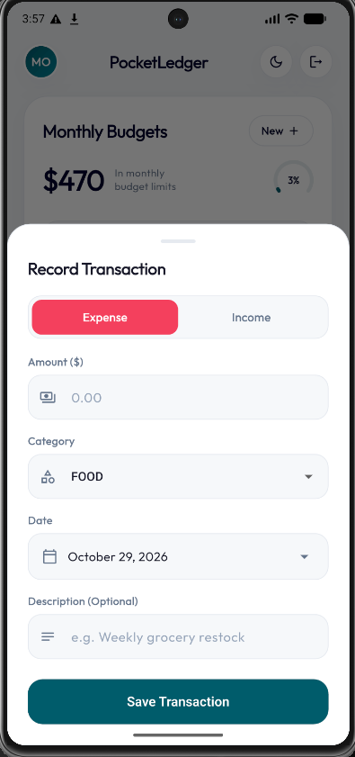 |
| **Live Search & Segmented Filtering**: Includes a pill search bar (`Search transactions or categories...`), segmented filter pills (`All`, `Income`, `Expenses`), and date-grouped Bento cards (`Today`, `Yesterday`, date) with category icon badges, color-coded amounts (`-$12.00`, `+$12,000.00`), tap-to-edit, and swipe-to-delete. | **Quick Transaction Logging**: Accessible from the floating `+` dock button or dashboard sparkle button. Provides a segmented **Expense / Income** toggle, active currency amount input, category selector (`FOOD`, `HOUSING`, `SALARY`, etc.), date picker, and optional description. |

---

### 3. Monthly Category Budgets & Smart Insights
Track spending velocity across categories with real-time progress bars and threshold alerts.

| 📊 Monthly Budgets & Smart Insight | 🎯 Set Monthly Budget Limit Dialog |
| :---: | :---: |
| 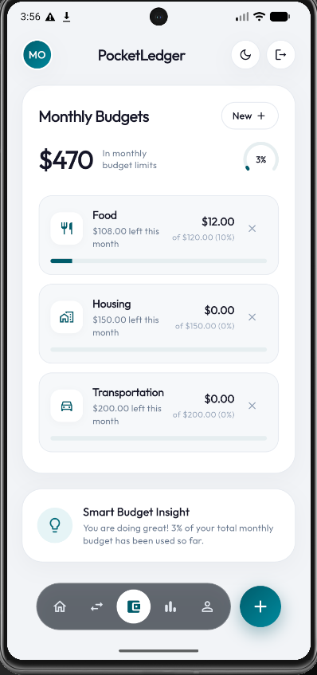 | 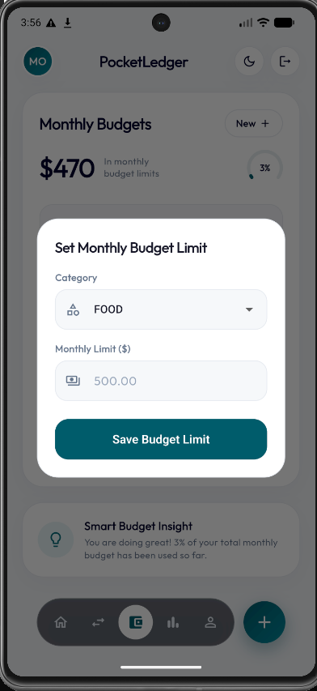 |
| **Category Spending Caps**: Displays total monthly budget allocation (`$470 In monthly budget limits`) alongside a circular percentage arc gauge (`3%`), nested category cards (`Food`, `Housing`, `Transportation`) showing remaining budget (`$108.00 left this month`), and a dynamic **Smart Budget Insight** card. | **Configure Category Limits**: Tapping `New +` opens the **Set Monthly Budget Limit** modal to assign or update monthly spending caps per category with automatic `SAFE`, `WARNING (80%+)`, and `EXCEEDED (100%+)` threshold tracking. |

---

### 4. Savings Goals & Milestone Deposits
Create long-term financial targets and log atomic contributions toward each milestone.

| 🏆 Financial Goals Overview | 🚩 Create Savings Goal | 💰 Deposit to Savings Goal |
| :---: | :---: | :---: |
| 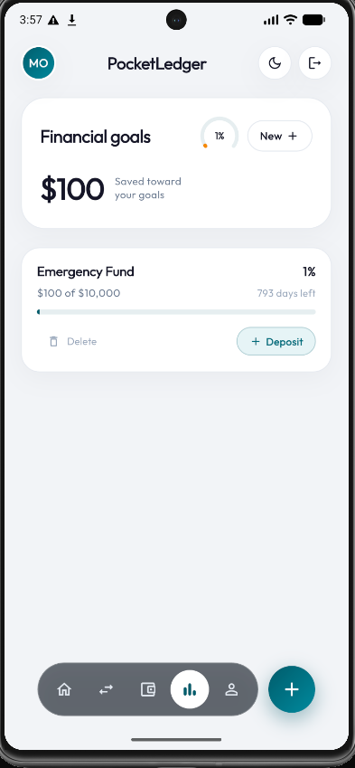 | 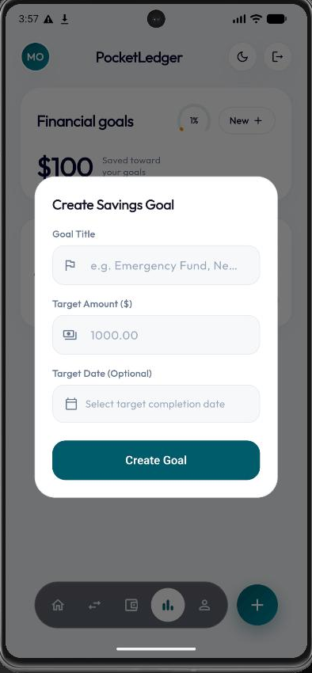 | 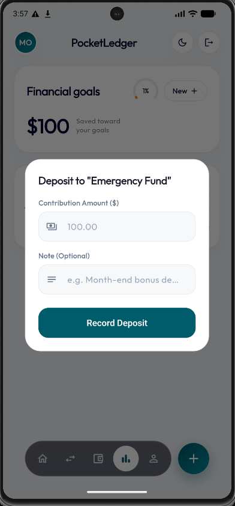 |
| **Milestone Progress Cards**: Shows aggregate savings (`$100 Saved toward your goals`) with a circular arc gauge, individual goal cards (`Emergency Fund — $100 of $10,000`), countdown timer (`793 days left`), slim progress bar, and a `+ Deposit` pill button. | **New Goal Modal**: Define a custom **Goal Title** (e.g., `Emergency Fund`), **Target Amount**, and optional **Target Completion Date** to track daily/monthly progress. | **Atomic Contribution Logging**: Tapping `+ Deposit` opens the contribution modal (`Deposit to "Emergency Fund"`) to record a deposit amount and note within an atomic database transaction. |

---

### 5. User Profile & Instant 10-Currency Global Switcher
Manage personal account details, security preferences, and global currency formatting from a dedicated profile hub.

| 👤 User Identity & Instant Global Currency Switcher | 🔍 Profile Capabilities |
| :---: | :--- |
| 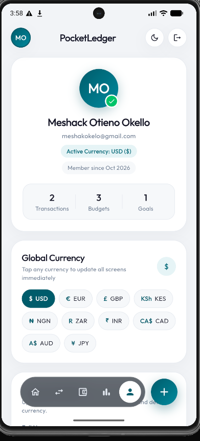 | <ul><li>**Verified Identity Card**: Displays user initials badge (`MO`) with verified indicator, full name, email address, active currency pill (`Active Currency: USD ($)`), membership date, and live counters for **Transactions**, **Budgets**, and **Goals**.</li><li>**Instant 10-Currency Global Switcher**: One-tap pill selector supporting **`USD ($)`**, **`EUR (€)`**, **`GBP (£)`**, **`KES (KSh)`**, **`NGN (₦)`**, **`ZAR (R)`**, **`INR (₹)`**, **`CAD (CA$)`**, **`AUD (A$)`**, and **`JPY (¥)`**. Selecting any currency immediately updates every screen, chart tooltip, budget card, and input dialog across the app and syncs with the backend (`PUT /api/v1/auth/me`).</li><li>**Personal Details & Security**: Edit full name, email, and default currency, toggle **Dark Mode** or **Privacy Balance Mask (`••••`)**, and update account passwords (`POST /api/v1/auth/change-password`).</li></ul> |

---

## 🌟 System Architecture

PocketLedger is structured as a **modular monolith** on the backend (`auth`, `transaction`, `budget`, `savings`, `analytics`, `pocketledger-service`) paired with a **Riverpod 2.x** reactive Flutter frontend:

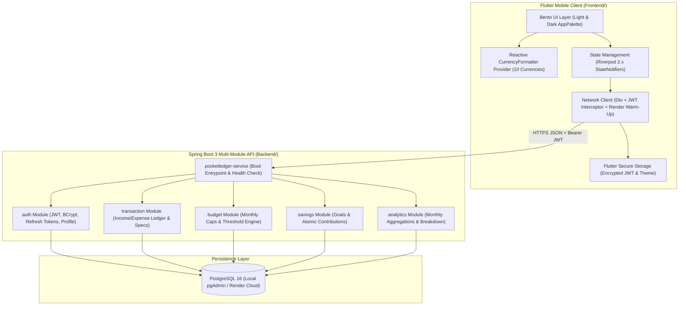

---

## 🗄️ Relational Database Schema

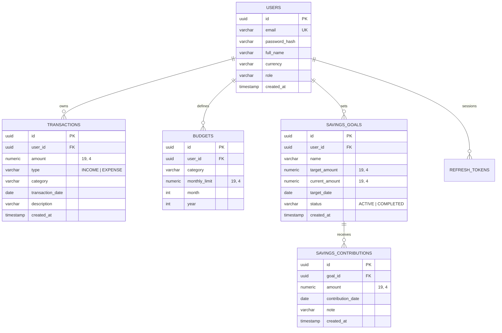

---

## 🚀 Key Engineering Pillars

### 1. Financial Accuracy & Multi-Tenancy
* **Zero Floating-Point Drift**: All monetary figures in Java are modeled using `BigDecimal` mapped to `NUMERIC` columns in PostgreSQL.
* **Strict Tenancy Isolation**: Every JPA repository query and service operation scopes data by the authenticated `UserPrincipal` ID (`WHERE user_id = :userId`).

### 2. Enterprise Spring Security 6 & JWT
* Stateless HMAC-SHA256 access tokens (`JJWT 0.12.6`), refresh token rotation, token blacklisting, and BCrypt password hashing.
* Live profile & currency synchronization (`PUT /api/v1/auth/me`) that issues a fresh JWT when user claims change.

### 3. Reactive Mobile Architecture (Flutter + Riverpod)
* **Dual-Theme `AppPalette` Extension**: Custom `ThemeExtension<AppPalette>` delivering zero-lag switching between **Editorial Alabaster Light Mode** and **Obsidian Dark Mode**.
* **Global Reactive Currency Engine**: Watching `currencyFormatterProvider` updates currency symbols, compact notations, and input labels across every screen instantaneously.

---

## ⚡ Quickstart & Deployment

### 1. Live Cloud Backend (Render)
The backend is deployed on **Render** using [`render.yaml`](render.yaml) and [`Backend/Dockerfile`](Backend/Dockerfile):
* **Base API URL**: `https://pocketledger-backend.onrender.com/api/v1`
* **Health Check**: [`https://pocketledger-backend.onrender.com/api/v1/health`](https://pocketledger-backend.onrender.com/api/v1/health)
* **Swagger UI**: [`https://pocketledger-backend.onrender.com/swagger-ui.html`](https://pocketledger-backend.onrender.com/swagger-ui.html)

### 2. Running the Backend Locally (Gradle + PostgreSQL)
```bash
cd Backend

# Build all 6 modules and executable Spring Boot JAR
./gradlew :pocketledger-service:bootJar -x test --no-daemon

# Run the Spring Boot service locally on http://localhost:8080
./gradlew :pocketledger-service:bootRun --no-daemon
```

### 3. Running the Flutter Mobile Client
```bash
cd Frontend

# 1. Install dependencies
flutter pub get

# 2. Run unit & widget test suite
flutter test

# 3. Run on Android Emulator or Physical Device
flutter run -d emulator-5554

# 4. Build Production Release APK
flutter build apk --release --android-skip-build-dependency-validation
```

---

## 📚 REST API Reference

| Method | Endpoint | Description | Auth Required |
| :--- | :--- | :--- | :--- |
| `GET` | `/api/v1/health` | Service health check probe | No |
| `POST` | `/api/v1/auth/register` | Register a new user account with preferred currency | No |
| `POST` | `/api/v1/auth/login` | Authenticate user and issue JWT + refresh token | No |
| `GET` | `/api/v1/auth/me` | Fetch currently authenticated user profile | Yes |
| `PUT` | `/api/v1/auth/me` | Update user full name, email, and global currency | Yes |
| `POST` | `/api/v1/auth/change-password` | Update authenticated user password | Yes |
| `GET` | `/api/v1/transactions` | List/filter transactions (type, category, date range) | Yes |
| `POST` | `/api/v1/transactions` | Record a new income or expense transaction | Yes |
| `PUT` | `/api/v1/transactions/{id}` | Update an existing transaction | Yes |
| `DELETE` | `/api/v1/transactions/{id}` | Delete a transaction | Yes |
| `GET` | `/api/v1/analytics/monthly-summary` | Monthly income, expenses, net savings & category breakdown | Yes |
| `GET` | `/api/v1/budgets/progress` | Monthly category budget limits vs actual spending | Yes |
| `POST` | `/api/v1/budgets` | Create or update a monthly category budget limit | Yes |
| `DELETE` | `/api/v1/budgets/{id}` | Delete a category budget limit | Yes |
| `GET` | `/api/v1/savings-goals` | List savings goals with completion percentages | Yes |
| `POST` | `/api/v1/savings-goals` | Create a new target savings goal | Yes |
| `POST` | `/api/v1/savings-goals/{id}/contributions` | Record an atomic deposit toward a savings goal | Yes |
| `DELETE` | `/api/v1/savings-goals/{id}` | Delete a savings goal | Yes |

---

## 👨‍💻 Project Information
* **Developer**: Meshack Otieno Okello
* **Specialization**: Spring Boot & Flutter Full-Stack Software Engineer
* **License**: MIT
