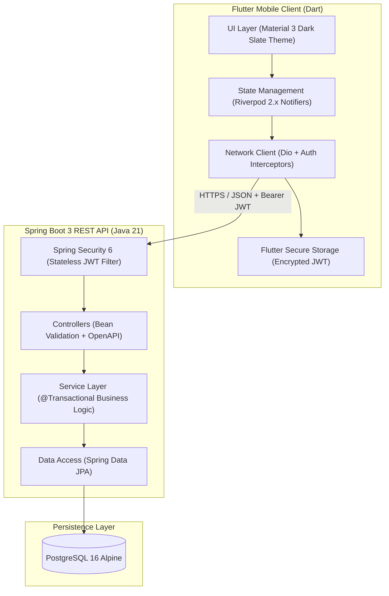
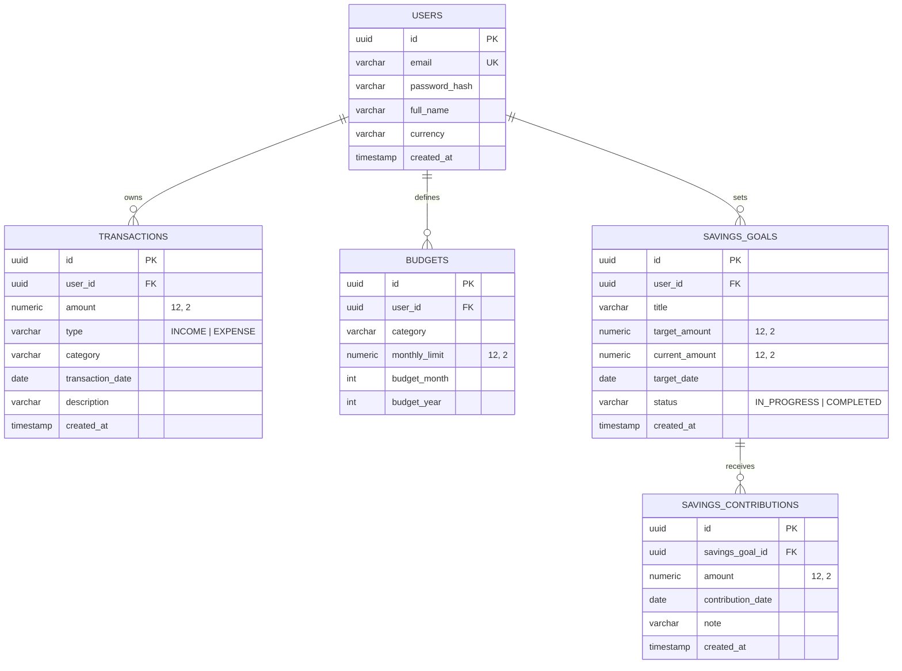

# PocketLedger 🪙

[](https://openjdk.org/)
[](https://spring.io/projects/spring-boot)
[](https://flutter.dev/)
[](https://www.postgresql.org/)
[](https://www.docker.com/)
[](https://jwt.io/)

> **PocketLedger** is a full-stack personal finance and budgeting mobile ecosystem engineered to demonstrate production-grade architecture. It combines a reactive **Flutter** mobile client with an enterprise-ready **Spring Boot 3** REST API backed by **PostgreSQL 16**.

---

## 🌟 System Architecture



---

## 🗄️ Relational Database Schema



---

## 🚀 Key Engineering Pillars

### 1. Financial Accuracy & Multi-Tenancy
* **Zero Floating-Point Drift**: All currency amounts in Java are modeled using `BigDecimal` and mapped to `NUMERIC(12, 2)` in PostgreSQL. Standard IEEE 754 floating-point arithmetic is strictly avoided.
* **Strict Tenancy Isolation**: Security isn't just checked at endpoints; every JPA query and service operation enforces `WHERE user_id = :authenticatedUserId` to guarantee complete privacy across user accounts.

### 2. Enterprise Spring Security 6 & JWT
* Stateless session architecture using HMAC-SHA256 tokens (`JJWT 0.12`).
* Passwords hashed with BCrypt.
* Auto-configured OpenAPI 3.0 (Swagger UI) with interactive Bearer Authentication support.

### 3. Reactive Mobile Architecture (Flutter + Riverpod)
* Layered separation: `core/`, `data/`, and `presentation/`.
* Dio HTTP client equipped with request interceptors to auto-attach tokens and error interceptors to trigger smooth session redirects on 401s.
* Responsive `fl_chart` donut visualizations and real-time budget threshold warnings (`SAFE` green, `WARNING_80` amber, `EXCEEDED` red).

### 4. Atomic Transactional Integrity
* Savings goal deposits use Spring's `@Transactional` boundary to guarantee that both the contribution log entry and the updated target balance persist atomically.

---

## ⚡ Quickstart & Deployment

### Option A: One-Command Docker Compose (Recommended)

Starts both **PostgreSQL 16** and the **Spring Boot API** in isolated containers:

```bash
docker compose up -d --build
```

* API Base URL: `http://localhost:8080`
* Interactive Swagger UI: `http://localhost:8080/swagger-ui/index.html`
* OpenAPI JSON Spec: `http://localhost:8080/api-docs`
* PostgreSQL Port: `localhost:5433` (DB: `pocketledger_db`, User: `postgres`, Pass: `postgrespassword`)

---

### Option B: Running the Backend Locally

```bash
# 1. Start PostgreSQL
docker compose up -d postgres

# 2. Compile and run test suite (100% pass)
cd Backend
./mvnw clean test

# 3. Start Spring Boot
./mvnw spring-boot:run
```

---

### Option C: Running the Flutter Mobile Client

```bash
cd Frontend

# 1. Install Flutter dependencies
flutter pub get

# 2. Run unit & widget tests (100% pass)
flutter test

# 3. Check connected devices
flutter devices

# 4. Launch on Android Emulator (Recommended)
flutter run -d emulator-5554
# or on Chrome
flutter run -d chrome
```

---

## 📚 REST API Reference

| Method | Endpoint | Description | Auth Required |
| :--- | :--- | :--- | :--- |
| `POST` | `/api/v1/auth/register` | Create user account | No |
| `POST` | `/api/v1/auth/login` | Authenticate & get JWT | No |
| `GET` | `/api/v1/auth/me` | Fetch authenticated profile | Yes |
| `GET` | `/api/v1/transactions` | List/filter transactions (page, size, type, category, date range) | Yes |
| `POST` | `/api/v1/transactions` | Record income or expense | Yes |
| `PUT` | `/api/v1/transactions/{id}` | Update existing transaction | Yes |
| `DELETE` | `/api/v1/transactions/{id}` | Delete transaction | Yes |
| `GET` | `/api/v1/analytics/monthly-summary` | Income, expense, net savings & category breakdown | Yes |
| `GET` | `/api/v1/budgets/progress` | Budget limits vs actual spending with warning flags | Yes |
| `POST` | `/api/v1/budgets` | Set or update monthly category budget | Yes |
| `GET` | `/api/v1/savings-goals` | List savings goals with progress percentages | Yes |
| `POST` | `/api/v1/savings-goals` | Create target savings goal | Yes |
| `POST` | `/api/v1/savings-goals/{id}/contributions` | Record deposit towards savings goal | Yes |

---

## 🧪 Testing Strategy

* **Spring Boot**:
  * `AuthServiceTest`: Unit testing registration and login edge-cases using Mockito.
  * `TransactionServiceTest`: Verifies user tenancy isolation and ownership checks.
  * `AnalyticsServiceTest`: Verifies math calculations (savings rates, percentage ratios).
  * `AuthControllerTest`: MockMvc slice testing for HTTP status codes and RFC 7807 validation responses.
* **Flutter**:
  * `models_test.dart`: Serialization, date parsing, and computed status logic tests.

---

## 👨‍💻 Project Information
* **Developer**: Meshack Otieno
* **Specialization**: Spring Boot & Flutter Full-Stack Software Engineer
* **License**: MIT
